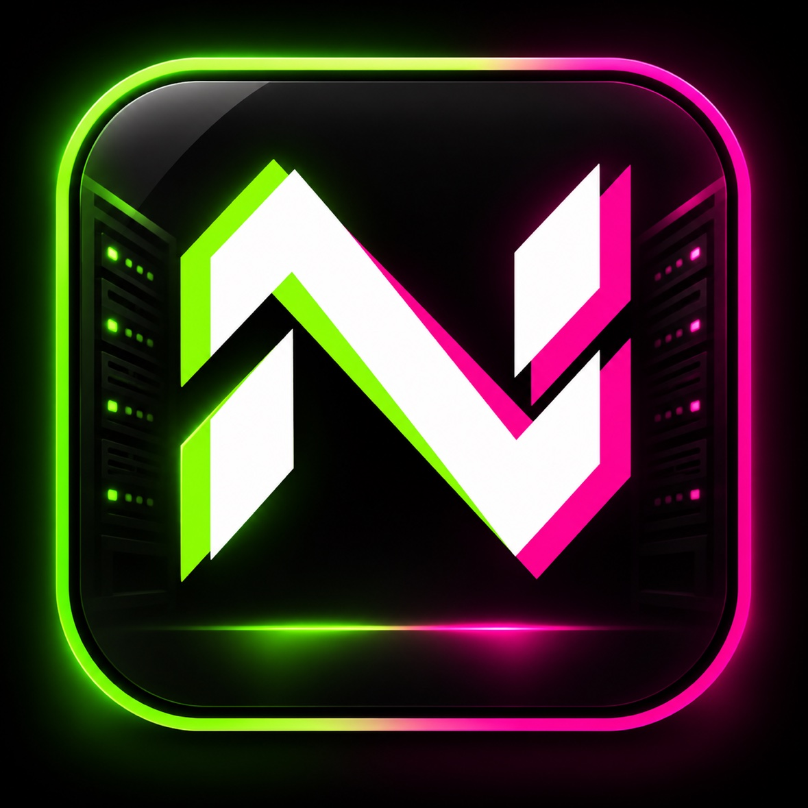
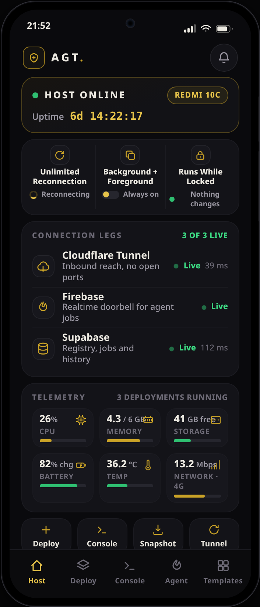
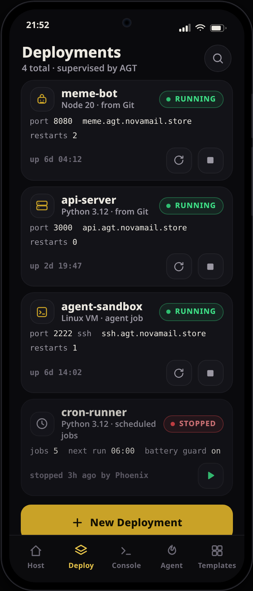
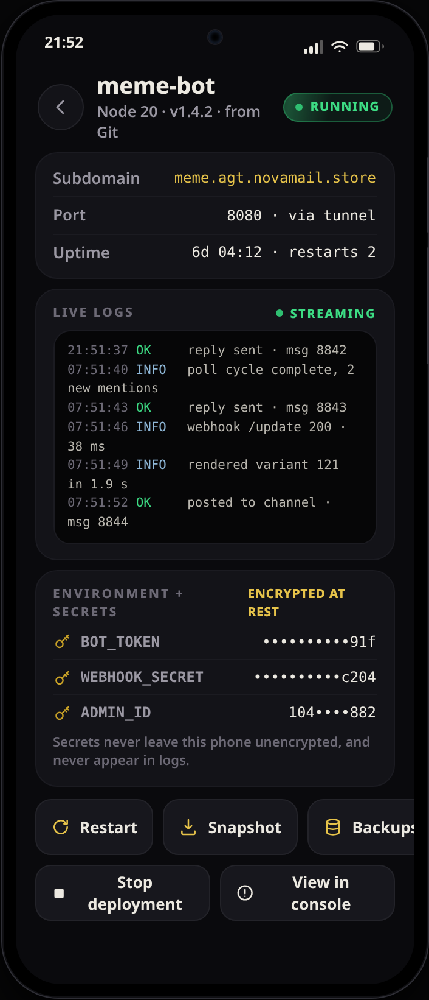
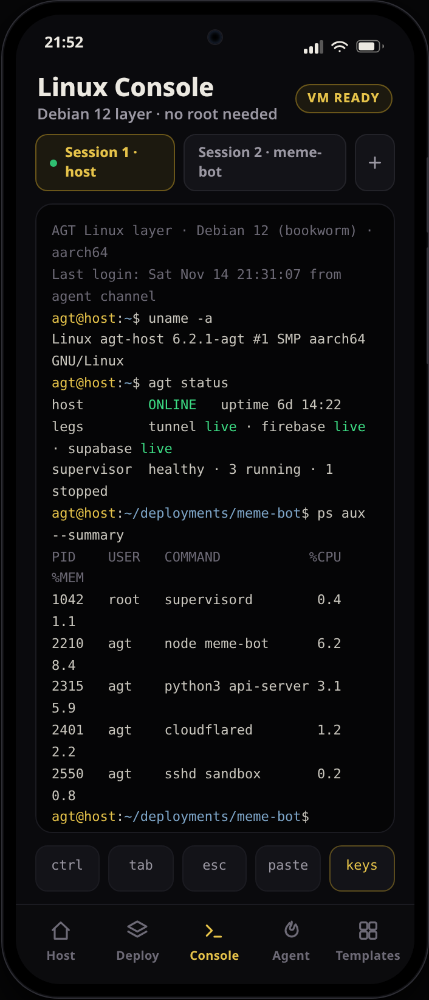
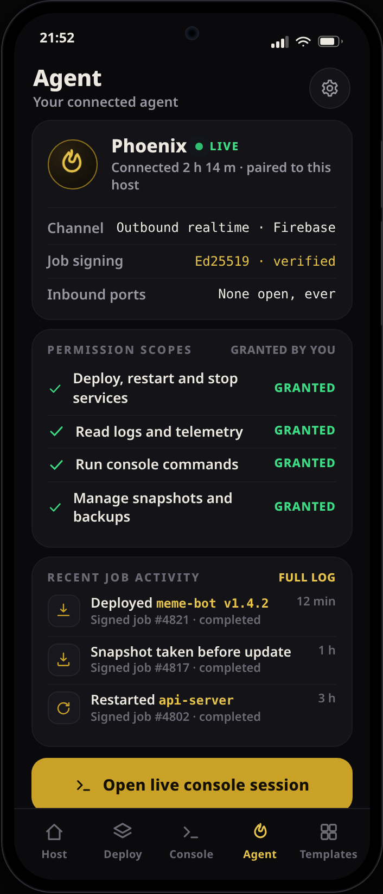
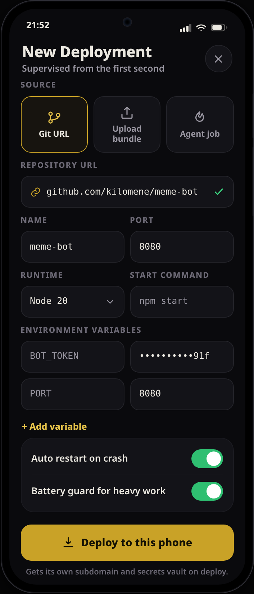
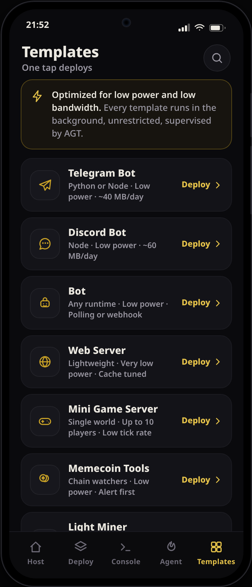
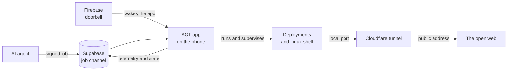

  

# AGT

**Your phone is the server.**

AGT is an Android app that turns an ordinary phone into a real Linux hosting
server. Install it, and the phone can host bots, web servers, APIs, small
game servers, scheduled jobs, and AI agent workloads around the clock, with
public web addresses, automatic restarts, and an AI agent connected to it
that can deploy and operate everything for you.

AGT is a Nova Inc project, created by Zenas Ayansipe Olatunde.

## What AGT does, in plain words

A server is just a computer that stays on and answers requests. AGT makes a
phone into that computer:

- It carries a full Linux layer inside the app: a real shell, real programs
  (bash, Python, Git, curl, Node.js, BusyBox), all built for the phone.
- It runs your programs as **deployments** and supervises them. If one
  crashes, AGT restarts it. If the phone reboots, AGT brings everything back.
- It gives each deployment a public address on the web, so people and
  services can reach what you host without you opening any router ports.
- It connects to an AI agent over a signed job channel. The agent can deploy
  code, run commands, read logs, and manage the server for you, while every
  job is checked against a key you paired and approved on the phone itself.
- It is built to never sleep: it holds through the lock screen, the
  background, and network drops, and reconnects on its own without limit.

## The app, screen by screen

The pictures below come from the AGT design kit, the exact design the app is
built to: matte black, AGT gold, and an emerald status light, with a bottom
bar of five tabs: Host, Deploy, Console, Agent, Templates.

### 1. Host

The home screen: the phone as a server, at a glance. It shows whether the
host is online, which phone it is, how long it has been up, and the live
state of the three connections that keep it reachable (Cloudflare, Firebase,
Supabase, explained below). Think of it as the dashboard of your server: if
anything needs attention, it shows here first.

### 2. Deployments

Every program you host lives here as a deployment card: its name, what it
runs on (for example Node or Python), whether it is RUNNING or STOPPED, its
port, its public address, how many times AGT has restarted it, and how long
it has been up. Each card has quick restart and stop controls, and the gold
button at the bottom starts a new deployment.

### 3. Deployment Detail

Tap any deployment and you get its full page: public address and port, live
streaming logs, and the full set of controls (restart, stop, remove). This
is where you watch what a hosted program is actually doing, line by line, as
it happens.

### 4. Linux Console

A real Linux terminal inside the app, not a simulation. This is a live shell
into the phone's own Linux layer: you can type commands, install and run
tools, edit files, and work exactly as you would on a Linux server. The
shell is a persistent process owned by the app's background service, so your
session stays alive when you leave the screen, lock the phone, or switch
apps, and you can hold more than one session at once.

### 5. Agent

This screen shows the AI agent paired to this host: who it is, whether it is
live, and how long it has been connected. Pairing is deliberate: an agent can
only work on a phone whose owner has admitted its key on this screen, and
the owner can revoke it here at any time. Each admitted agent also gets its
own private vault inside the app, where its secrets are stored encrypted and
injected into its deployments. One agent's vault is never visible to another.

### 6. New Deployment

The form for putting something new on the server. Give it a name, choose a
source (a Git address, an uploaded bundle, an agent job, or a template),
pick a port and a start command, and AGT takes it from there: the deployment
is supervised from the first second, gets its public address, and appears in
the Deployments list.

### 7. Templates

Ready made starting points for common things people host: bots, small web
servers, APIs, scheduled jobs, and more. Every template is tuned for low
power and low bandwidth, because the server is a phone. Pick one, and the
New Deployment form arrives mostly filled in.

## How it works

AGT stands on three legs, each doing one job:

- **Cloudflare** carries the public traffic. A tunnel from the phone to
  Cloudflare means deployments get public addresses with HTTPS, with no
  inbound port opened on the phone and no public IP needed.
- **Firebase** is the doorbell and the presence light. It wakes the app the
  moment an agent sends work, and shows whether the host is online. It
  carries no data of record.
- **Supabase** is the database of record and the job channel. Deployments,
  telemetry, and signed agent jobs live there, and the app syncs with it
  continuously.

Here is the whole flow, from an agent deciding to run something to the world
reaching it:

Step by step, a deployment going live looks like this:

1. An agent sends a signed deploy job, or the owner fills in the New
   Deployment form on the phone.
2. Firebase rings the doorbell, so the app reacts at once, not on a timer.
3. AGT prepares the deployment inside its Linux layer and starts it under
   the supervisor.
4. The supervisor watches it from the first second: crashes are restarted
   with backoff, and the deployment is restored after any reboot.
5. The Cloudflare tunnel publishes it at its own address, in the form
   `name-agt.novamail.store` on the Nova Inc setup, and the world can reach
   it over HTTPS.
6. Logs, state, and telemetry stream back to the app and the database, so
   the owner and the agent always see the truth of what is running.

## AGT and Termux: the difference

People ask, so here it is plainly.

**AGT is not Termux, does not use Termux, and depends on no Termux code or
Termux packages.** Nothing from Termux is inside this app.

What the two share is a *way of building*, and only that. Termux proved that
a real Linux userland can be compiled from source to live inside an Android
app's own private folder (its prefix) and run as ordinary app processes, with
no root and no system changes. AGT's Linux layer is built the same way:
every program in it, bash, BusyBox, Python, Git, curl, Node.js and the rest,
was compiled from source for AGT's own prefix, and the whole layer ships
inside the app and answers to the app alone.

The purpose is different, and that is the real distinction:

- Termux is a terminal environment for a person sitting at the phone: a
  workshop for your own hands.
- AGT is a hosting server that happens to live on a phone: supervised
  deployments, public addresses, an always on background service, and a
  signed channel for AI agents to operate it. The console is one screen of
  five, not the whole product.

AGT also replaces the older Termux based stack this project started from.
That stack is retired. This app is the native successor, written from the
ground up.

## Run your own AGT

This repository is public so anyone can study it and fork it. A fork is a
full copy you own: build it with your own backend accounts and it becomes
your own server platform, separate from Nova Inc's.

To build your own you need:

- Your own Supabase project (the database and job channel).
- Your own Firebase project (the doorbell and presence).
- Your own Cloudflare tunnel (the public entry).
- Your own signing key for your builds.

These are supplied to the build as secrets (see `.github/workflows/build.yml`
for the exact list). Nothing in the code points a fork at Nova Inc's
accounts: the configuration is injected at build time, never committed.

**About the official build download:** there is none, by design. This
repo's GitHub Action publishes no downloadable artifacts at all. The built
app is encrypted the moment it is built and held in that locked form on a
separate delivery branch, and only Nova Inc holds the key that opens it.
This is because the official build carries Nova Inc's own backend
configuration. The code is open to fork; the company's running app is not a
public download. If you want AGT, fork the repo and build yours.

## Copyright and license

AGT is copyrighted work.

Copyright (c) 2026 Zenas Ayansipe Olatunde and Nova Inc. All rights are held
by the copyright owners, and the software is licensed under the MIT License
(see [LICENSE](LICENSE)).

In plain words: you may fork this repository, study it, build on it, and run
your own. What you may not do is claim the work as your own, remove the
copyright notices, or present yourself as its author. Every copy or
substantial portion must keep the copyright and license notices, as the
license states. Fork it and build something of yours on it; the original
remains its author's.

## Status

AGT is live and in daily use: version 1.6.20 is installed on the owner's
phone, hosting real deployments, with its Linux shell, agent channel, and
public routing all proven on device.
